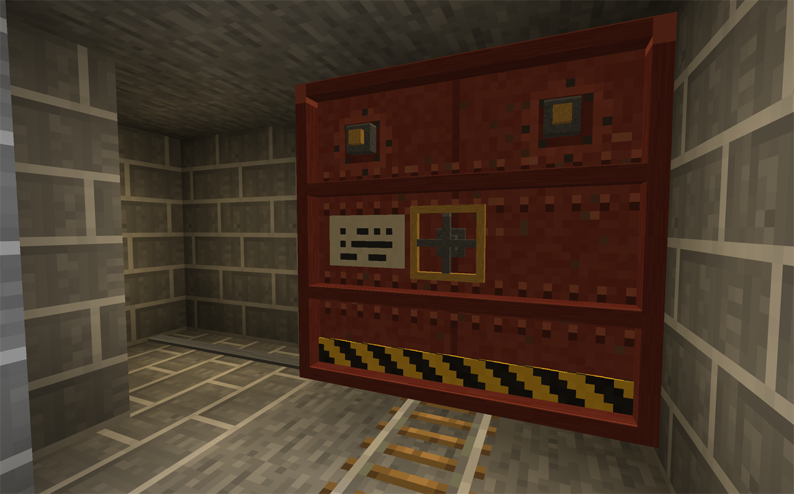
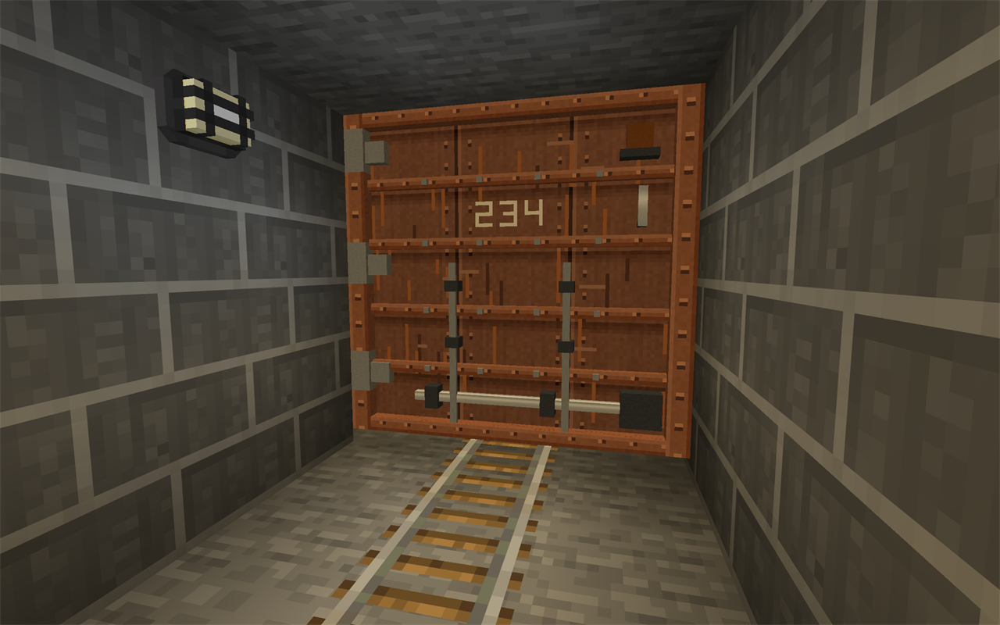
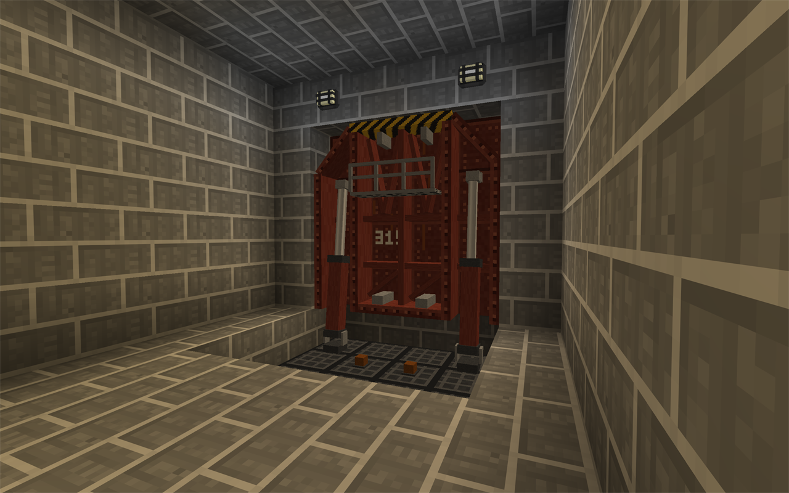

[English](README.md) | **Русский**

# NTM NEXT Blast Doors Addon — гермодвери для Minecraft 26.2 / NeoForge

Тяжёлые двери для тоннелей метро и бункеров, управляются редстоуном:

- **Откатная гермодверь** (Railway Slide Blast Door) — дверь 3×3 с рельсом в проёме, как в тоннеле метро: створка уезжает вбок.
- **Распашная гермодверь** (Railway Side Blast Door) — дверь 3×3 на рельсах: створка на петлях уходит в нишу сбоку от пути.
- **Станционный гермозатвор** (Station Air-Tight Gates) — плита 4×4, которая лежит в полу как его часть
  и поднимается, перекрывая проход, как затворы на станциях глубокого заложения.

Правила у всех дверей общие. Сигнал редстоуна на любом блоке двери открывает её, без сигнала она
закрывается. Проём становится проходимым примерно на половине хода, а дверь ждёт и не прищемит того,
кто ей мешает. Двери добываются киркой не хуже алмазной, вдвое твёрже обсидиана, взрывостойкость 450,
поршни их не сдвигают. Сломали любой блок — выпадает вся дверь одним предметом. Предметы лежат
во вкладке «Механизмы».

## Откатная гермодверь (3×3, на рельсах)



Створка за 6 секунд уезжает вбок на 3 блока. Закрытая перекрывает путь и останавливает вагонетки.

1. Встаньте на путь **лицом вдоль рельсов** и поставьте дверь **вместо рельса**.
   Место 3×3 поперёк пути должно быть свободно.
2. **Shift при установке** — створка будет откатываться в другую сторону.

Створка уезжает в «карман» 3×3 рядом с проёмом; если там стена, дверь уходит в неё. Ригели, штурвал
и сигнальные лампы анимированы.

## Распашная гермодверь (3×3, на рельсах)



Створка на вертикальных петлях примерно за 7 секунд поворачивается из положения поперёк пути в нишу
сбоку от него. Закрывает её гидроцилиндр на оборотной стороне. Закрытая дверь останавливает вагонетки.

1. Рядом с путём сделайте нишу для открытой створки: 1 блок в ширину, 3 в длину, 3 в высоту.
   Она начинается на линии двери и идёт вдоль пути от вас — **слева**, а с **Shift** при установке справа.
2. Встаньте на путь **лицом вдоль рельсов** и поставьте дверь **вместо рельса**. Место 3×3 поперёк
   пути и ниша должны быть свободны; если нет, игра подскажет.

Дверь не закрывается, пока кто-то есть в проёме или в двух блоках перед ним со стороны ниши.
Открытие не ждёт, поэтому сквозь вагонетку, стоящую у самой двери, створка пройдёт визуально.

## Станционный гермозатвор (4×4)



Плита на петле у пола. С сигналом она лежит в полу, и по ней ходят; без сигнала примерно за 10 секунд
поднимается и закрывает проём 4×4.

1. Выкопайте углубление 4 блока в ширину, 4 в длину и 1 в глубину: первый ряд — прямо под проёмом,
   остальные — за ним.
2. Встаньте перед проёмом **лицом к нему** и поставьте затвор в **ближний ряд** углубления.
   Он займёт 1 блок правее поставленного и 2 левее; если места нет, игра подскажет.

Полом плита становится, только когда легла до конца; до этого и пока затвор закрыт, на её месте
приямок. Всё, что окажется в приямке, когда плита ляжет, будет на ней. Гидроцилиндры, складная
служебная площадка и сигнальные лампы в приямке анимированы.

## Крафт

С установленным NTM NEXT двери собираются в **сборочной машине** (Assembly Machine), по 200 тиков:

| Материал | Откатная гермодверь | Распашная гермодверь | Станционный гермозатвор |
|---|---|---|---|
| стальная пластина | 16 | 18 | 24 |
| свинцовая пластина | 6 | 6 | 8 |
| резина (любая) | 4 | 4 | 4 |
| болт из быстрорежущей стали | 8 | 8 | 12 |
| мотор | 2 | 1 | 2 |
| рельс | 1 | 1 | — |

Без NTM NEXT работают запасные рецепты на обычном верстаке (с NTM они отключены):

```
Откатная        Распашная        Гермозатвор

I I I           I I I            I I I        I — железный блок
I P I           P I O            I I I        P — поршень
O R O           I R I            P O P        O — обсидиан, R — рельс
```

## Совместимость с NTM NEXT

Если установлен [NTM NEXT](https://github.com/Warfactory-Official/ntm-next) (mod id `hbm`), закрытая
дверь или затвор не пропускает радиацию — так же, как двери самого NTM, — и начинает пропускать её с той же половины хода, с которой перестаёт мешать проходу.
Без NTM мод работает как обычно: зависимость необязательная и в jar не попадает.

Взрывостойкость (450) такая же, как у дюкретовых кирпичей NTM, и выше, чем у бетонных
кирпичей (96). Ядерные взрывы NTM считают её по тому же числу.

## Сборка и запуск

Нужен **JDK 25** (Mojang поставляет Java 25 для 26.2).

```bash
./gradlew runClient     # запустить игру с модом
./gradlew build         # собрать jar → build/libs/blastdoor-1.7.4.jar
```

На Windows — `gradlew.bat`. Готовый jar кладётся в папку `mods` клиента с NeoForge 26.2.
Версии задаются в `gradle.properties` (`neo_version=26.2.0.90`); свежую версию можно взять на
https://projects.neoforged.net/neoforged/neoforge.

## Устройство кода

| Файл | Что делает |
|---|---|
| `BlastDoorMod.java` | Регистрация блоков, предметов, блок-сущностей, вкладка творческого режима |
| `blockentity/AbstractDoorBlockEntity.java` | Общая логика всех дверей: прогресс анимации, открытие/закрытие по редстоуну, звуки, синхронизация |
| `item/BlastDoorItem.java` | Предмет двери: строка «Blast Resistance» во всплывающей подсказке |
| `compat/NtmCompat.java` | Совместимость с NTM NEXT: закрытые двери регистрируются как защита от радиации |
| `client/BoxMesh.java` | Построитель текстурированных коробок, из них нарисованы все створки |
| `client/DoorRumbleSound.java` | Глухой гул, который клиент проигрывает, пока створка движется |
| `block/AbstractRailDoorBlock.java` | Общее для двух рельсовых дверей: контроллер — прямой рельс (`BaseRailBlock`), установка, коллизия, редстоун |
| `blockentity/AbstractRailDoorBlockEntity.java` | Общее для двух рельсовых дверей: остановка вагонеток, выравнивание формы рельса |
| **Откатная гермодверь** | |
| `block/BlastDoorBlock.java` | Контроллер: рельс и список 8 частей вокруг него |
| `block/BlastDoorPartBlock.java` | Невидимые части 3×3: коллизия, приём сигнала, разрушение всей структуры |
| `block/DoorGeometry.java` | Координаты частей, формы коллизии, объём проёма |
| `blockentity/BlastDoorBlockEntity.java` | Структура 3×3 и проверка «проём свободен» |
| `client/BlastDoorRenderer.java` | Рисует створку (лист, клёпаная рама и рёбра, круглый штурвал, сигнальные лампы, ригели, катки) и направляющую |
| **Распашная гермодверь** | |
| `block/SideDoorBlock.java` | Контроллер: рельс и список частей проёма и ниши |
| `block/SideDoorPartBlock.java` | Невидимые части проёма и ниши: коллизия, приём сигнала, разрушение всей структуры |
| `block/SideDoorGeometry.java` | Координаты ниши, её объём, зона, через которую проходит створка |
| `blockentity/SideDoorBlockEntity.java` | Ожидание свободной зоны, выталкивание всего из ниши |
| `client/SideDoorRenderer.java` | Рисует створку (плита, рамы, петли, привод запоров, балки оборотной стороны, ригели, лампы) и гидроцилиндр, который её двигает |
| **Станционный гермозатвор** | |
| `block/StationGateBlock.java` | Контроллер: блок пола в ближнем ряду углубления |
| `block/StationGatePartBlock.java` | Невидимые части пола и проёма: коллизия, приём сигнала, разрушение всей структуры |
| `block/StationGateGeometry.java` | Координаты частей, приямок, объём, который задевает плита |
| `blockentity/StationGateBlockEntity.java` | Ожидание свободного пути, подъём всего из приямка |
| `client/StationGateRenderer.java` | Рисует плиту (настил, рама, раскосы), гидроцилиндры, складную площадку и приямок с сигнальными лампами |

Настройки, которые легко поменять:

- скорость — `TRAVEL_TICKS` в `BlastDoorBlockEntity`, `SideDoorBlockEntity` и `StationGateBlockEntity`;
- внешний вид — методы `draw…` в рендерерах и текстуры в `assets/blastdoor/textures/entity/`;
- звуки — звуки начала и конца хода заданы вызовами `playSound(...)` в `AbstractDoorBlockEntity`; глухой гул во время движения — `client/DoorRumbleSound`.
